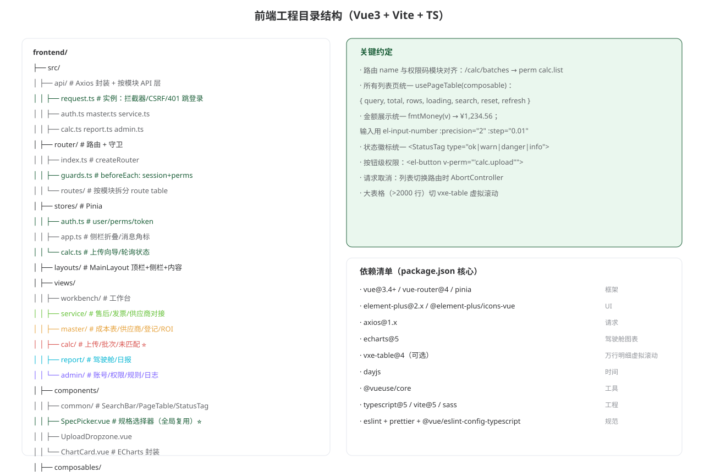
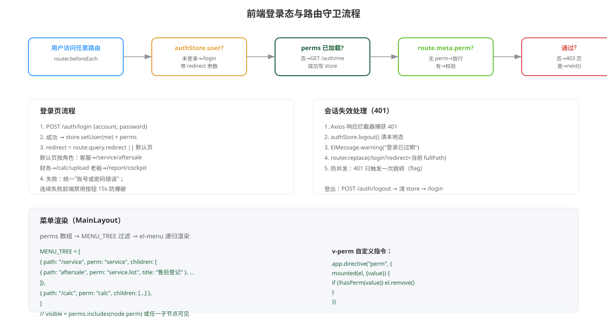
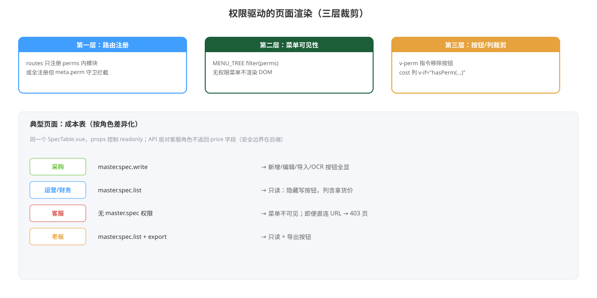
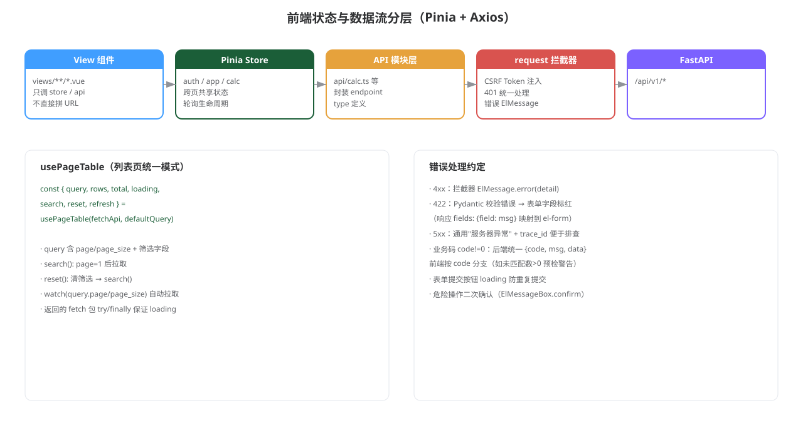
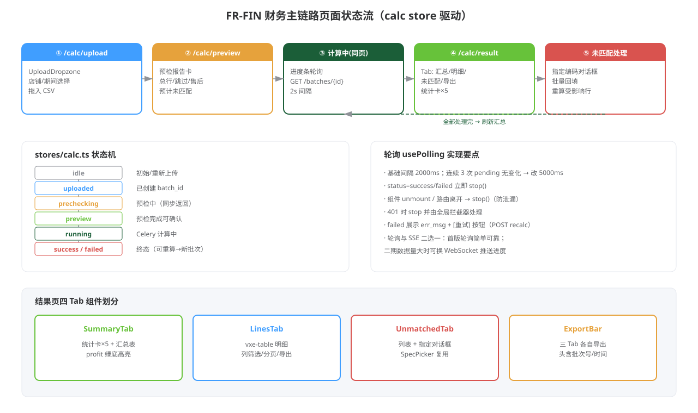

# BLACK ERP 前端开发文档

> 版本：v1.0 · 日期：2026-10-20
> 依赖：《架构设计文档》《产品设计 00~09 / 10-页面原型》《后端开发文档》
> 组织方式：**按需求点（FR）维度**，每个 FR 给出页面/组件/状态流/权限/对接 API
> 技术栈：Vue 3.4 + TypeScript + Vite 5 + Element Plus 2 + Pinia + Axios + ECharts 5

---

## 0. 工程总览与公共约定

### 0.1 目录结构



### 0.2 初始化

```bash
npm create vite@latest frontend -- --template vue-ts
cd frontend
npm i element-plus @element-plus/icons-vue vue-router@4 pinia axios echarts dayjs @vueuse/core
npm i -D vite-plugin-vue-devtools sass eslint prettier @vue/eslint-config-typescript
# 可选（万行明细）
npm i vxe-table
```

`vite.config.ts`：

```ts
export default defineConfig({
  plugins: [vue()],
  server: {
    port: 5173,
    proxy: { '/api': { target: 'http://localhost:8000', changeOrigin: true } },
  },
})
```

### 0.3 全局样式变量（对齐原型）

```scss
// styles/vars.scss
$--color-primary: #1b5e38;   // Element Plus 主题覆盖
$--color-success: #67c23a;
$--color-warning: #e6a23c;
$--color-danger: #d9534f;
```

主色 `#1B5E38`、成功 `#67C23A`、警告 `#E6A23C`、危险 `#D9534F`、侧栏 `#1F2D3D`。

### 0.4 请求层

```ts
// api/request.ts
import axios from 'axios'
import { useAuthStore } from '@/stores/auth'
import { ElMessage } from 'element-plus'
import router from '@/router'

const request = axios.create({ baseURL: '/api/v1', timeout: 30000 })

request.interceptors.request.use((config) => {
  const auth = useAuthStore()
  if (auth.csrfToken && !['get', 'head'].includes(config.method!)) {
    config.headers['X-CSRF-Token'] = auth.csrfToken
  }
  return config
})

let redirecting = false
request.interceptors.response.use(
  (res) => res.data,
  (err) => {
    const status = err.response?.status
    if (status === 401 && !redirecting) {
      redirecting = true
      useAuthStore().logout()
      ElMessage.warning('登录已过期')
      router.replace(`/login?redirect=${encodeURIComponent(router.currentRoute.value.fullPath)}`)
        .finally(() => { redirecting = false })
    } else if (status !== 401) {
      ElMessage.error(err.response?.data?.detail || '请求失败')
    }
    return Promise.reject(err)
  },
)
export default request
```

### 0.5 API 模块层示例

```ts
// api/calc.ts
import request from './request'
export interface Batch { id: number; shop_name: string; period: string; status: string; version: number; stats: any }

export const calcApi = {
  upload(file: File, shopId?: number, period?: string) {
    const fd = new FormData()
    fd.append('file', file)
    if (shopId) fd.append('shop_id', String(shopId))
    if (period) fd.append('period', period)
    return request.post('/calc/batches', fd, { headers: { 'Content-Type': 'multipart/form-data' } })
  },
  list: (params: any) => request.get('/calc/batches', { params }),
  get: (id: number) => request.get(`/calc/batches/${id}`),
  summary: (id: number) => request.get(`/calc/batches/${id}/summary`),
  lines: (id: number, params: any) => request.get(`/calc/batches/${id}/lines`, { params }),
  unmatched: (id: number) => request.get(`/calc/batches/${id}/unmatched`),
  manualMatch: (id: number, body: { line_ids: number[]; spec_id: number }) =>
    request.post(`/calc/batches/${id}/manual-match`, body),
  recalc: (id: number) => request.post(`/calc/batches/${id}/recalc`),
  exportTab: (id: number, tab: string) =>
    request.get(`/calc/batches/${id}/export`, { params: { tab }, responseType: 'blob' }),
}
```

### 0.6 Composables

```ts
// composables/usePageTable.ts
export function usePageTable<T>(fetcher: (params: any) => Promise<{ items: T[]; total: number }>,
                                defaults: Record<string, any> = {}) {
  const query = reactive({ page: 1, page_size: 20, ...defaults })
  const rows = ref<T[]>([])
  const total = ref(0)
  const loading = ref(false)

  async function load() {
    loading.value = true
    try {
      const res = await fetcher(query)
      rows.value = res.items; total.value = res.total
    } finally { loading.value = false }
  }
  function search() { query.page = 1; load() }
  function reset() { Object.assign(query, defaults, { page: 1 }); load() }
  watch(() => [query.page, query.page_size], load)
  return { query, rows, total, loading, search, reset, refresh: load }
}
```

```ts
// composables/usePolling.ts
export function usePolling(fn: () => Promise<void>, interval = 2000) {
  let timer: number | null = null
  let slowCount = 0
  const running = ref(false)
  async function tick() {
    await fn()
    slowCount++
    const ms = slowCount > 3 ? 5000 : interval
    timer = window.setTimeout(tick, ms)
  }
  function start() { if (!running.value) { running.value = true; tick() } }
  function stop() { running.value = false; if (timer) clearTimeout(timer) }
  return { start, stop, running }
}
```

### 0.7 金额与时间工具

```ts
// utils/money.ts
export const fmtMoney = (v: string | number | null | undefined) =>
  v == null ? '-' : '¥' + Number(v).toLocaleString('zh-CN', { minimumFractionDigits: 2, maximumFractionDigits: 2 })

// utils/day.ts
import dayjs from 'dayjs'
import 'dayjs/locale/zh-cn'
dayjs.locale('zh-cn')
export const fmtDate = (v: string) => dayjs(v).format('YYYY-MM-DD')
export const fmtDateTime = (v: string) => dayjs(v).format('YYYY-MM-DD HH:mm')
```

---

## 1. 布局与权限框架（FR-Auth / S1）

### 1.1 登录态与路由守卫



### 1.2 MainLayout

```vue
<!-- layouts/MainLayout.vue -->
<template>
  <div class="layout">
    <header class="topbar">
      <span class="logo">BLACK ERP</span>
      <el-badge :value="unreadCount" :hidden="!unreadCount" class="msg">
        <el-icon @click="msgDrawer = true"><Bell /></el-icon>
      </el-badge>
      <el-dropdown @command="onUserCmd">
        <span>{{ auth.user?.display_name }} <el-icon><ArrowDown /></el-icon></span>
        <template #dropdown>
          <el-dropdown-item command="logout">退出登录</el-dropdown-item>
        </template>
      </el-dropdown>
    </header>
    <aside class="sider">
      <el-menu :default-active="$route.path" router>
        <!-- 递归渲染 MENU_TREE ∩ perms -->
      </el-menu>
    </aside>
    <main class="content"><router-view /></main>
    <MessageDrawer v-model="msgDrawer" />
  </div>
</template>
```

### 1.3 菜单树与 v-perm

```ts
// router/menu.ts
export const MENU_TREE = [
  { path: '/workbench', title: '工作台', perm: null, icon: 'Home' },
  { path: '/service', title: '客服工作台', perm: 'service', children: [
    { path: 'aftersale', title: '售后登记', perm: 'service.list' },
    { path: 'invoices', title: '发票管理', perm: 'service.list' },
    { path: 'suppliers', title: '供应商对接', perm: 'service' },
  ]},
  { path: '/master', title: '成本报价', perm: 'master', children: [
    { path: 'suppliers', title: '供应商管理', perm: 'master.supplier.list' },
    { path: 'specs', title: '规格成本表', perm: 'master.spec.list' },
    { path: 'shop-products', title: '店铺产品登记', perm: 'master.shop_product.list' },
    { path: 'roi', title: 'ROI 计算', perm: 'roi' },
  ]},
  { path: '/calc', title: '财务核算', perm: 'calc', children: [
    { path: 'upload', title: '订单上传与计算', perm: 'calc.list' },
    { path: 'batches', title: '计算批次', perm: 'calc.list' },
    { path: 'unmatched', title: '未匹配处理', perm: 'calc.list' },
  ]},
  { path: '/report', title: '经营驾驶舱', perm: 'report', children: [
    { path: 'cockpit', title: '利润总览', perm: 'report.list' },
    { path: 'daily', title: '经营日报', perm: 'report.list' },
  ]},
  { path: '/admin', title: '系统管理', perm: 'admin', children: [
    { path: 'accounts', title: '账号管理', perm: 'admin.list' },
    { path: 'perms', title: '角色与权限', perm: 'admin.perm_assign' },
    { path: 'region-rules', title: '附加成本规则', perm: 'admin.update' },
    { path: 'logs', title: '操作日志', perm: 'admin.list' },
  ]},
]
```

```ts
// composables/usePermission.ts
export function usePermission() {
  const auth = useAuthStore()
  const has = (code?: string | null) => !code || auth.perms.includes(code)
  return { has, perms: computed(() => auth.perms) }
}

// main.ts 注册指令
app.directive('perm', {
  mounted(el, binding) {
    const { has } = usePermission()
    if (!has(binding.value)) el.parentNode?.removeChild(el)
  },
})
```

### 1.4 权限三层裁剪



### 1.5 状态与数据流分层



### 1.6 默认落地页

| 角色 | redirect |
|------|----------|
| 客服 | /service/aftersale |
| 采购 | /master/specs |
| 运营 | /master/shop-products |
| 财务 | /calc/upload |
| 老板/管理员 | /report/cockpit |

---

## 2. 公共组件（跨 FR 复用）

| 组件 | 职责 | 使用 FR |
|------|------|---------|
| `SearchBar` | 筛选条插槽 + 搜索/重置按钮 | 全部列表 |
| `PageTable` | 表格+分页封装，对接 usePageTable | 全部列表 |
| `StatusTag` | ok/warn/danger/info 徽标 | 全部 |
| `SpecPicker` ⭐ | 规格选择对话框：搜索编码/产品名，单选，返回 spec 全量 | FR-OP 登记、FR-FIN 未匹配 |
| `UploadDropzone` | 拖拽上传，accept 可配，进度条 | FR-FIN CSV、FR-CS 附件、FR-PO XLSX |
| `ChartCard` | ECharts 驱动卡片（柱/线） | FR-REPORT |
| `MoneyText` | fmtMoney 展示，null→'-' | 全部金额列 |
| `ConfirmDanger` | 危险操作二次确认（输入确认词可选） | 删除/重算/忽略 |

### 2.1 SpecPicker 示例

```vue
<!-- components/SpecPicker.vue -->
<script setup lang="ts">
const props = defineProps<{ modelValue: boolean; shopId?: number }>()
const emit = defineEmits(['update:modelValue', 'select'])
const { query, rows, total, loading, search } = usePageTable(
  (p) => masterApi.specPicker({ ...p, shop_id: props.shopId }),
)
watch(() => props.modelValue, (v) => v && search())
function pick(row: Spec) { emit('select', row); emit('update:modelValue', false) }
</script>

<template>
  <el-dialog :model-value="modelValue" title="选择规格编码" width="720"
             @update:model-value="$emit('update:modelValue', $event)">
    <SearchBar v-model="query.q" @search="search" placeholder="编码 / 产品名 / 规格名" />
    <el-table v-loading="loading" :data="rows" @row-click="pick" highlight-current-row>
      <el-table-column prop="spec_code" label="编码" width="120" />
      <el-table-column prop="product_name" label="产品名称" />
      <el-table-column prop="spec_name" label="规格" width="140" />
      <el-table-column prop="price" label="拿货价" width="100">
        <template #default="{ row }"><MoneyText :value="row.price" /></template>
      </el-table-column>
    </el-table>
    <Pagination v-model:page="query.page" v-model:page-size="query.page_size" :total="total" />
  </el-dialog>
</template>
```

- **只显示启用态** Spec；编码只读，不可手输（对齐 FR-OP-01）

---

## 3. FR-CS · 客服模块页面（S4）

### 3.1 售后登记 `/service/aftersale`

- 组件：`AftersaleList.vue` + `AftersaleDrawer.vue`
- 列表列：订单号、客户（脱敏）、类型、描述截断、状态、处理人、时间、详情
- 抽屉字段：关联订单号*、客户昵称/联系方式、问题类型（单选）、问题描述*、处理结果、处理状态*
- API：`serviceApi.aftersales.*`
- 权限：`v-perm="'service.create'"` 控制新增按钮

### 3.2 发票管理 `/service/invoices`

- Tab：发票列表 / 提醒记录
- 回传对话框：`UploadDropzone` accept=`.jpg,.png,.pdf`，多文件；成功后行状态→已回传
- 提醒记录：类型、计划时间、状态（待触发/成功/失败）、重试次数

### 3.3 供应商对接 `/service/suppliers`

- 复用供应商列表组件，**客服角色 API 不返回价格字段**（后端过滤）
- 可编辑：对接微信群/联系人/电话/备注；不可见拿货价

---

## 4. FR-PO · 采购/主数据页面（S2）

### 4.1 规格成本表 `/master/specs` ⭐

- 组件：`SpecTable.vue` + `SpecFormDrawer.vue` + `PriceHistoryDrawer.vue`
- 工具栏：新增规格（primary）/ 导入 XLSX / 下载模板 / 导出
- 列表列：编码、产品名称、规格、拿货价、供应商、更新时间、操作[编辑][历史]
- 新增抽屉字段：产品名称*、规格名*、默认供应商*、本版拿货价*、产品图片、备注
  - 保存成功 toast：`编码 SP000125 已生成`；编码不可编辑
- 编辑价格 → 调 `/specs/{id}/price`（只追加历史）
- **只读态**（运营/财务/老板）：`props.readonly` 隐藏写按钮，保留搜索/导出

```vue
<SpecTable :readonly="!has('master.spec.write')" :show-export="has('master.spec.export')" />
```

### 4.2 XLSX 导入对话框

- 步骤条：上传 → 表头校验 → 预检统计 → 确认导入
- 表头缺失：整表拒绝，列出缺失列
- 行级异常：可下载异常行文件（blob）
- API：`masterApi.importXlsx(file)` 两阶段（dry-run / commit）或一次带 `confirm=true`

### 4.3 店铺产品登记 `/master/shop-products`（FR-OP-01）

- 列表 + 三步对话框（对齐原型 p08）
- 步骤 ② 用 `SpecPicker`，**编码只读展示不可手输**
- 保存前若同规格已有售价：提示"新售价将并存，靠订单金额区分"
- 同店 (标题, 售价) 重复 → 后端 409，前端 ElMessage.error(detail)

### 4.4 ROI `/master/roi`（FR-OP-03）

- 输入花费/成交金额 → watch 即时算 ROI（前端除法，后端存储）
- 历史列表：月份、花费、成交、ROI、保存人

---

## 5. FR-FIN · 财务核算页面（S3 核心）

### 5.1 主链路状态流



### 5.2 stores/calc.ts

```ts
export const useCalcStore = defineStore('calc', () => {
  const phase = ref<'idle'|'uploaded'|'preview'|'running'|'success'|'failed'>('idle')
  const batchId = ref<number>()
  const preview = ref<Preview>()
  const batch = ref<Batch>()

  async function upload(file: File, shopId?: number, period?: string) {
    phase.value = 'uploaded'
    const res = await calcApi.upload(file, shopId, period)
    batchId.value = res.batch_id
    preview.value = res.preview
    phase.value = 'preview'
  }
  async function confirmRun() {
    // 后端上传时已 enqueue；此处仅切 phase 并开始轮询
    phase.value = 'running'
    poll.start()
  }
  async function fetchStatus() {
    const b = await calcApi.get(batchId.value!)
    batch.value = b
    if (b.status === 'success') { phase.value = 'success'; poll.stop(); router.push(`/calc/result/${b.id}`) }
    if (b.status === 'failed') { phase.value = 'failed'; poll.stop() }
  }
  const poll = usePolling(fetchStatus, 2000)
  onUnmounted(() => poll.stop())
  return { phase, batchId, preview, batch, upload, confirmRun, poll }
})
```

### 5.3 页面拆分

| 路由 | 组件 | 职责 |
|------|------|------|
| /calc/upload | `CalcUpload.vue` | 店铺/期间选择 + Dropzone + 预检卡 + 确认计算 |
| /calc/result/:id | `CalcResult.vue` | 统计卡×5 + Tab 容器 |
| ↳ SummaryTab | `SummaryTab.vue` | 汇总表（单批次=stats） |
| ↳ LinesTab | `LinesTab.vue` | vxe-table 明细，列筛选/分页/导出 |
| ↳ UnmatchedTab | `UnmatchedTab.vue` | 未匹配+推荐+指定对话框 |
| /calc/batches | `BatchList.vue` | 批次列表+重算确认弹窗 |
| /calc/unmatched | 跨批次入口 | 从工作台/驾驶舱横幅进入 |

### 5.4 未匹配指定对话框

```vue
<script setup lang="ts">
const props = defineProps<{ batchId: number; lines: UnmatchedLine[] }>()
const specPickerVisible = ref(false)
const selectedSpec = ref<Spec>()
const bulk = ref(true)   // 按文本相同批量指定

async function confirm() {
  await calcApi.manualMatch(props.batchId, {
    line_ids: props.lines.map(l => l.id),
    spec_id: selectedSpec.value!.spec_id,
  })
  ElMessage.success('已指定并沉淀匹配规则')
  emit('done')
}
</script>
```

- 二次确认文案："将回填同文本行并沉淀为匹配规则，后续自动命中"

### 5.5 明细列定义（LinesTab）

| 列 | 字段 | 备注 |
|----|------|------|
| 订单号 | order_no | |
| 选购商品 | raw_product | 超长截断+tooltip |
| 标题/规格 | title / spec_text | 拆分结果 |
| 命中编码 | spec_code | none 时红色"未匹配" |
| 拿货价 | price_snapshot | MoneyText |
| 地区附加 | surcharge | MoneyText |
| 数量 | qty | |
| 行成本 | line_cost | MoneyText |
| 收入 | income | MoneyText |
| 匹配方式 | matched | StatusTag auto绿/manual蓝/none红 |
| 售后状态 | aftersale_status | 仅展示 |

- >2000 行启用 `vxe-table` 虚拟滚动；否则 el-table

### 5.6 导出

- 三 Tab 各自 `ExportBar`：调 export 接口拿 blob → `URL.createObjectURL` 下载
- 文件名：`批次{batch_id}_{tab}_{period}.xlsx`

---

## 6. FR-REPORT · 工作台/驾驶舱/日报（S4）

### 6.1 工作台 `/workbench`

- 待办卡按角色显示（perms 驱动）：
  - 客服：发票提醒数（`serviceApi.reminderCount()`）
  - 财务：未匹配总数（跨批次 `calcApi.unmatchedTotal()`）
  - 采购：报价待补录
  - 老板：利润摘要卡
- 快捷入口 4 个主操作按钮
- 最近计算批次 + 我的登记动态（简化：两个列表卡片）

### 6.2 驾驶舱 `/report/cockpit`

- 4 指标卡：商家实收 / 发货单数 / 采购成本 / **利润**（绿底）
- `ChartCard`：店铺利润柱状图 + 近 6 月趋势折线（ECharts）
- 未匹配积压 > 0 → 顶部橙条，点击跳 `/calc/unmatched`（需 calc 权限，否则隐藏）

```ts
// 图表示例
option = {
  xAxis: { type: 'category', data: months },
  yAxis: { type: 'value' },
  series: [{ type: 'line', data: profits, smooth: true, areaStyle: { opacity: 0.15 } }],
  color: ['#1B5E38'],
}
```

### 6.3 日报 `/report/daily`

- 日期选择（默认昨日）→ 表格：店铺、订单量、成本、利润、环比
- 环比：上涨绿 / 下跌红（利润列）
- 导出按钮

---

## 7. 系统管理页面 `/admin/*`（S5）

| 路由 | 组件 | 要点 |
|------|------|------|
| accounts | AccountList | 列表+重置密码+停用；"模块覆盖"列有值高亮 |
| perms | PermSettings | 6 个模块开关（el-switch）；角色默认项标注；保存即生效 |
| region-rules | RegionRuleList | 预置 +4/+20；编辑金额/省份标签（el-select multiple）；说明条"按件计、仅影响之后计算" |
| logs | AuditLogList | 筛选：人/模块/动作/时间；变更摘要 before→after |

---

## 8. 消息中心（全局）

- `MessageDrawer.vue`：顶栏铃铛拉出 420px 抽屉；Tab 全部/提醒/任务
- 角标：`appStore.unreadCount`，轮询 60s 或登录后拉一次 + 事件刷新
- 单条消息 `command` 跳转对应处理页（如未匹配 → /calc/unmatched）

---

## 9. 构建与部署

```bash
# 开发
npm run dev          # :5173，proxy → :8000

# 生产
npm run build        # dist/
# Nginx 挂载 dist + 反代 /api → app:8000
```

`.env.production`：

```
VITE_APP_TITLE=BLACK ERP
```

- 路由 history 模式需 Nginx `try_files $uri $uri/ /index.html`
- 构建产物无环境变量硬编码；API 地址走相对路径 `/api/v1`

---

## 10. 里程碑切片（前端）

| 切片 | 交付 | 依赖后端 |
|------|------|----------|
| S1 | 登录/布局/菜单/守卫/403 页 | auth |
| S2 | 成本表 CRUD/导入/登记/ROI/供应商 | master |
| S3 | 上传→预检→轮询→结果四 Tab→未匹配指定→批次列表 | calc |
| S4 | 客服三页/工作台/驾驶舱/日报/消息 | service/report |
| S5 | 系统管理四页/导出/压测大表格切换 vxe | admin |

---

## 附录 · 常见问题排查

| 现象 | 排查 |
|------|------|
| 菜单全无 | /auth/me 返回 perms 空；查 module_overrides |
| 写接口 403 | 缺 X-CSRF-Token；或 perms 不含 `.create/.update` |
| 上传 413 | Nginx client_max_body_size 或后端 MAX_UPLOAD_MB |
| 轮询不停 | 组件 unmount 未 stop；检查 usePolling 生命周期 |
| 金额显示科学计数 | 后端返回字符串，前端勿 Number 再格式化丢失精度；用 MoneyText |
| 中文乱码 CSV | 后端已 utf-8-sig；前端不参与解析 |
