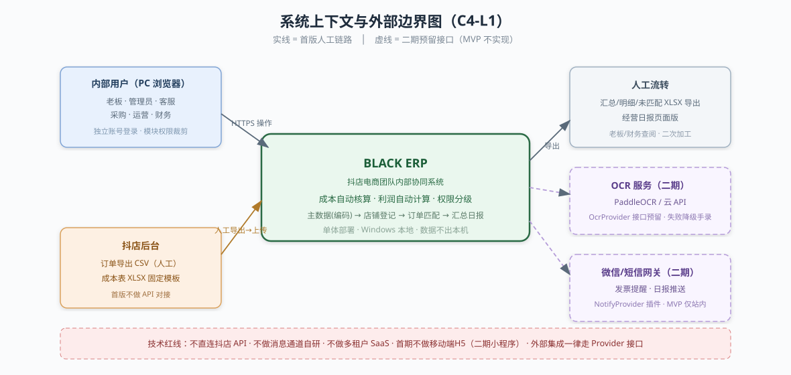
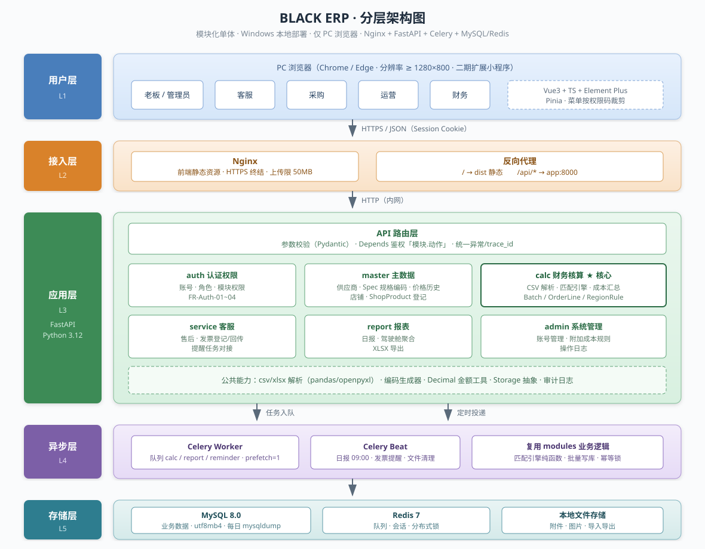
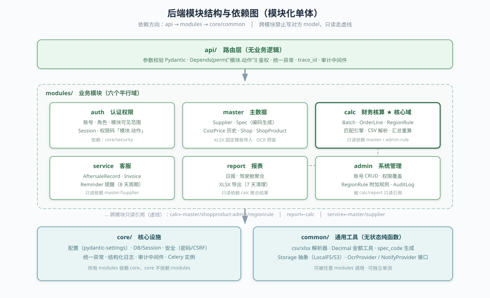
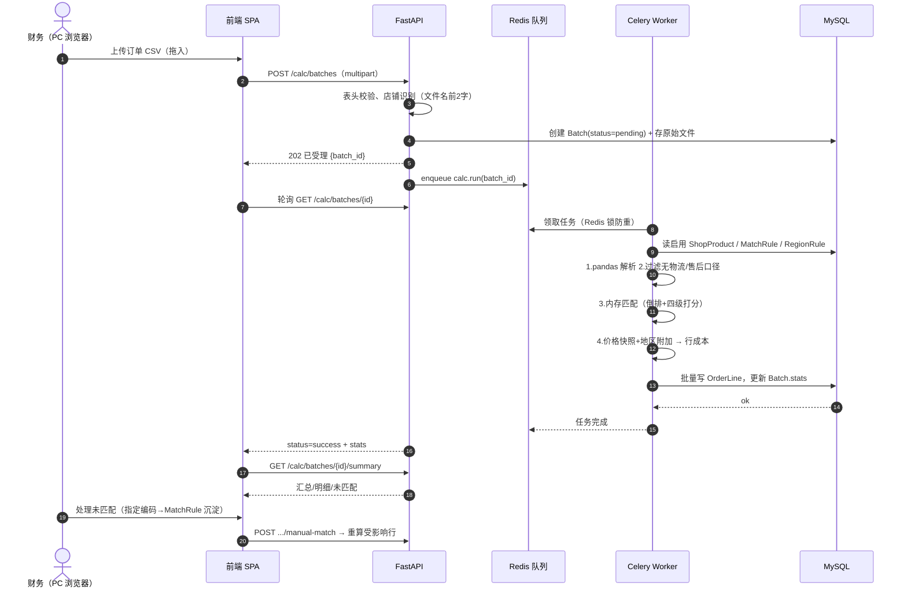
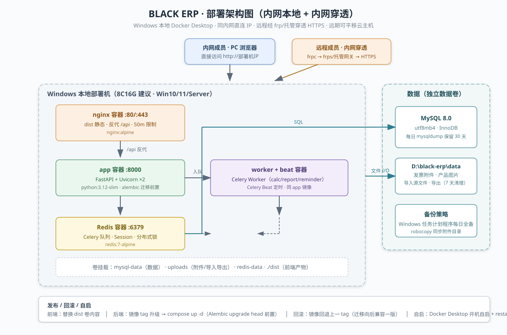
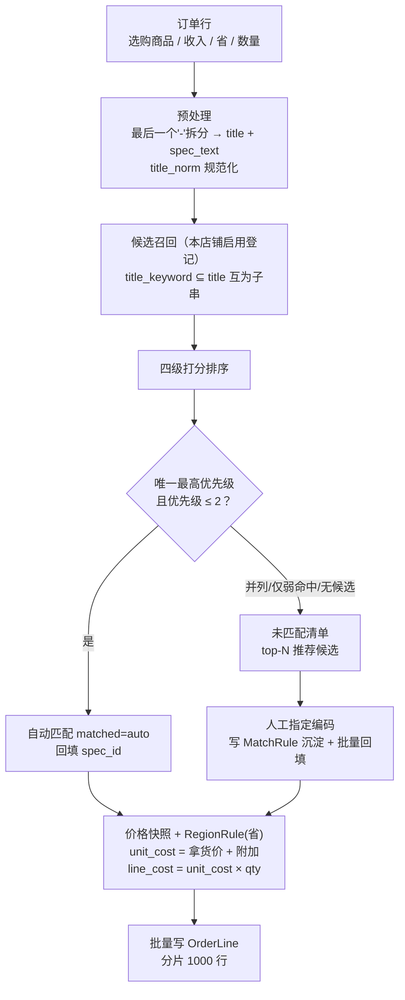
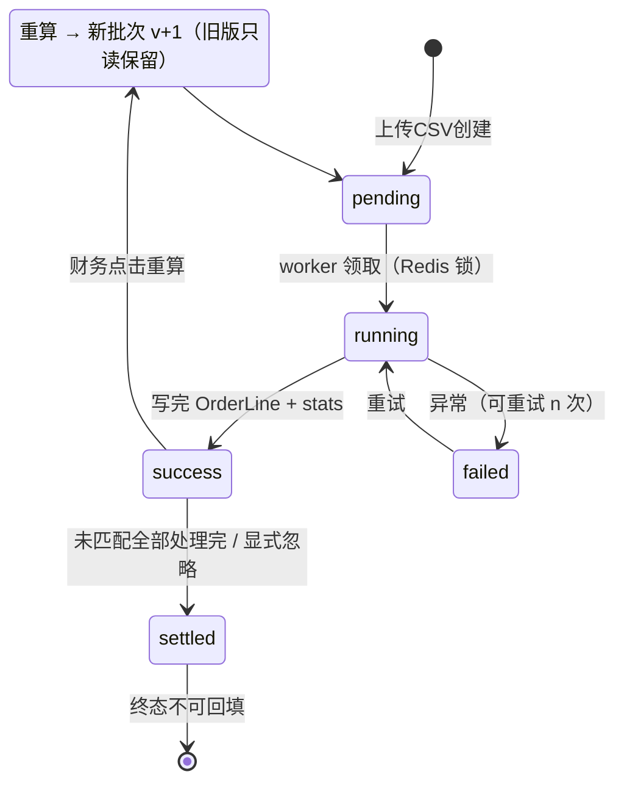

# BLACK ERP 架构设计文档

> 版本：v1.0 · 日期：2026-10-20
> 依赖：《BLACK ERP 需求文档》《BLACK ERP 产品设计文档》系列
> 部署形态：**内网 Windows 本地部署 + 内网穿透**（远期可迁云）；详见 §5 与《安全设计文档》
> 范围：架构目标与约束、总体架构、技术选型、技术边界、部署架构、关键技术方案、非功能实现、风险

---

## 1. 架构目标与约束

| 维度 | 结论 | 依据 |
|------|------|------|
| 用户规模 | 内部系统，同时在线 ≤ 20 人 | 五岗位小团队 |
| 客户端 | **首期仅 PC 浏览器**（Chrome/Edge 近两年版本，设计基准分辨率 ≥ 1280×800）；**二期扩展小程序**（API 优先设计，前端多端复用） | 本期明确约束 |
| 数据规模 | 单店铺月订单 ≤ 5 万行；全库订单行 ≤ 百万级 | NFR-07 |
| 部署形态 | **Windows 本地单机部署**（首期）；容器化交付，未来可平移到 Linux 服务器 | 内部系统，控制运维成本；见 §5 |
| 交付节奏 | MVP 快速落地，OCR/推送等二期平滑加装 | 产品设计第 7 节 |
| 核心质量 | **数据正确 > 性能 > 花活**；计算可追溯可重算 | NFR-08 |

**架构风格**：经典**单体分层架构**（模块化单体）。不做微服务——团队小、领域耦合强（成本/订单/汇总强一致），单体 + 清晰模块边界足够，未来需要再拆。

> 架构图采用 SVG 矢量图（`assets/` 目录），VS Code / GitHub 直接渲染；需要修改时编辑对应 SVG。时序与状态属 UML 图，保留 Mermaid 源码便于维护。

### 1.1 系统上下文（C4-L1）



---

## 2. 总体架构

### 2.1 分层架构图



五层自上而下：**用户层**（五岗位 PC 浏览器）→ **接入层**（Nginx 静态+反代）→ **应用层**（FastAPI：API 路由 + 六业务模块 + 公共能力）→ **异步层**（Celery Worker/Beat）→ **存储层**（MySQL/Redis/文件）。请求走左侧主干同步链路，重计算与定时任务走异步层，两层共享同一 modules 业务逻辑（worker 不重复实现）。

### 2.2 后端模块结构与依赖



```
app/
├── api/            # 路由层：只做参数校验与鉴权，不写业务
├── modules/
│   ├── auth/       # 账号、角色、权限（FR-Auth）
│   ├── master/     # 供应商、Spec 规格编码、CostPrice、店铺、ShopProduct
│   ├── calc/       # 批次、CSV 解析、匹配引擎、RegionRule、汇总 ⭐核心
│   ├── service/    # 售后、发票、提醒（客服模块）
│   ├── report/     # 日报、驾驶舱聚合、导出
│   └── admin/      # 账号管理、规则配置、操作日志
├── core/           # 配置、DB、安全、异常、日志
├── tasks/          # Celery 任务定义
└── common/         # 文件解析器、金额工具、编码生成器
```

**依赖方向规则**：`api → modules → core/common`；模块之间通过 service 接口调用，**禁止跨模块直接 import 对方 model 做写操作**（calc 读 master 的只读快照除外）。

### 2.3 一次"一键计算"的时序（关键链路）



---

## 3. 技术选型

### 3.1 选型总表

| 层 | 选型 | 版本 | 选它而不选别的的理由 |
|----|------|------|---------------------|
| 前端框架 | **Vue 3 + TypeScript + Vite** | Vue 3.4+ | 国内后台生态最成熟；TS 保质量；Vite 构建快；**二期小程序可用 uni-app/Taro 复用 Vue 语法与组件思路** |
| UI 库 | **Element Plus** | 2.x | 后台组件全（表格/抽屉/上传/穿梭框），中文文档；团队上手快 |
| 前端表格 | Element Plus Table + **vxe-table**（大数据量时启用） | — | 万行明细页用 vxe 虚拟滚动 |
| 前端状态/请求 | Pinia + Axios + Vue Router | — | 标准组合，不引 Next/SSR（纯内网后台无 SEO 需求） |
| 后端框架 | **FastAPI + Uvicorn** | Python 3.12 | 见 3.2 |
| ORM | SQLAlchemy 2.x + Alembic | — | 迁移管理成熟；异步驱动可选 |
| 数据校验 | Pydantic v2 | — | FastAPI 原生，DTO/设置/环境变量统一 |
| 任务队列 | **Celery + Redis** | — | 重计算/日报/提醒全部异步；失败重试原生支持 |
| 数据解析 | pandas + openpyxl | — | CSV/XLSX 工业级；后续可平滑加 polars |
| 数据库 | **MySQL 8.0**（InnoDB） | 8.0 | 团队熟悉度高、运维资料多；本场景无特殊 Postgres 需求 |
| 缓存/队列 | Redis 7 | — | 会话、队列、分布式锁（编码序列生成） |
| 对象存储 | 本地磁盘（可配 MinIO/S3） | — | 首版本地目录即可，存储接口抽象后可换 |
| 认证 | Cookie Session（Redis 存储）+ CSRF | — | 内部后台，比 JWT 更易踢人/吊销；不用第三方 OAuth |
| Web 服务器 | Nginx（前端静态 + 反代） | — | 标准 |
| 容器化 | Docker + docker-compose | — | 一键起：nginx/app/worker/redis/mysql |
| 图表 | ECharts 5（前端） | — | 驾驶舱柱状/折线足够 |
| OCR（二期） | PaddleOCR（自托管）或云 OCR API | — | 预留接口，不进 MVP 依赖 |

### 3.2 后端为什么选 FastAPI/Python（而不是 Java Spring Boot / Node）

本系统的复杂度重心不在高并发，而在**数据处理**：CSV/XLSX 解析、批量匹配、汇总计算、未来的 OCR——这些是 Python 的主场（pandas/openpyxl/paddleocr 生态无可替代）。FastAPI 提供：
- 声明式鉴权依赖（`Depends(require_module("calc", "write"))`）天然贴合模块权限矩阵
- Pydantic 做导入文件表头/行级校验
- Celery 生态成熟，任务与 Web 进程隔离

**放弃 Spring Boot 的原因**：开发与部署成本更高，而本项目无高并发/事务复杂度痛点。**放弃 Node 的原因**：大表格计算会阻塞事件循环，pandas 路线更稳。

### 3.3 前端为什么固定 Vue3+Element Plus，只做 PC

- 需求明确"操作界面简单、员工上手快"→ 标准后台布局（左侧菜单+顶栏+内容区），零学习成本
- 首期仅 PC：不做响应式断点；**二期小程序**走独立小程序端（uni-app/Taro），API 与 PC 共用一套 FastAPI
- 设计基准：1280 宽完整可用，1440/1920 用弹性留白

---

## 4. 技术边界（明确做什么、不做什么）

### 4.1 做

| 项 | 说明 |
|----|------|
| 单体 Web 应用 | 一个后端进程族（web + worker）+ 一个前端 SPA |
| 模块化单体内部纪律 | 模块目录 + 服务接口隔离，为未来拆分留缝 |
| 关系型数据一致性 | 批次/明细/汇总同一事务或幂等补写；金额 decimal |
| 异步计算 | 万行级 CSV 解析与匹配全部走 Celery，不占 HTTP 线程 |
| 文件导入导出 | 服务端解析，不做在线 Excel 编辑 |
| 权限双层 | 前端菜单裁剪 + 后端依赖注入鉴权 |
| 可替换存储 | `Storage` 接口：LocalFS 实现，预留 S3/MinIO |
| 外部集成预留 | OCR、抖店开放平台、微信推送：定义接口 + 配置开关，实现放二期 |

### 4.2 不做（技术红线）

| 不做 | 原因 |
|------|------|
| 微服务 / 分布式事务 | 规模不匹配，运维成本高 |
| 移动端 H5 / 响应式适配 | 首期仅 PC；**二期做小程序**（独立端，不做 H5 适配凑合） |
| 实时协同编辑（多人同时改同一行） | 内部低并发，乐观锁冲突提示即可 |
| SSR / Next.js / 服务端渲染 | 无 SEO 与首屏诉求 |
| 自研框架/脚手架 | 全用稳定生态 |
| 直连抖店 API 拉数 | 首版手动导出上传（产品决策）；预留 adapter 接口 |
| 在线预览原始 CSV 大文件 | 只展示解析结果与抽样 |
| 多租户 SaaS 化 | 单公司内部使用；"多店铺"是业务概念不是租户隔离 |
| 数据湖/BI 平台 | 万级数据 MySQL 聚合足够 |

### 4.3 与外部系统的边界

与 §1.1 上下文图为同一张图（实线 = 首版人工链路，虚线 = 二期 Provider 预留）：


系统**不负责**与抖店的 API 对接、不负责消息触达通道（微信/短信网关二期以 provider 插件形式接入）。

---

## 5. 部署架构（内网本地部署 + 内网穿透）

> 首期目标：部署在**内网一台 Windows 机器**上，同内网成员直接访问本机 IP；需要外网/远程访问时通过**内网穿透**暴露 HTTPS 入口。远期（有需要时）再整体迁移到云主机，架构不变、只换部署位置。

### 5.0 部署拓扑图



### 5.0b 网络接入形态

```
阶段一（当前）：
  同内网成员 ──http://192.168.x.x──→ Windows 部署机（Nginx :80）
  远程成员   ──HTTPS──→ 内网穿透网关（frp 客户端打洞）──→ 本机 Nginx

阶段二（云迁移，触发条件：并发/稳定性/远程规模不够用）：
  全体成员 ──HTTPS──→ 云主机（同 compose 栈，MySQL 数据卷迁移）
```

| 访问路径 | 阶段一做法 | 说明 |
|----------|-----------|------|
| 内网直连 | `http://部署机IP` | 最简；内网可信，但仍建议开登录+权限 |
| 远程/外网 | **内网穿透**：部署机跑 frpc，云上一台最小 VPS 跑 frps（或用 cpolar/花生壳等托管穿透） | 只映射 Nginx 80/443，**绝不映射 3306/6379** |
| 穿透入口安全 | 穿透域名必须 HTTPS；Nginx 加 Basic Auth 前置门禁（可选）+ 系统自身登录 | 见《安全设计文档》 |
| 云迁移 | 数据卷 mysqldump + uploads robocopy 迁移；compose 文件不变 | 迁移演练见安全文档 §迁移清单 |

**内网穿透注意**：穿透服务商可见流量路径，敏感部署建议自建 frps（VPS + 域名 + Let's Encrypt）；会话 Cookie 建议 `Secure + SameSite=Lax`，穿透域名与内网域名统一走同一 Nginx。

### 5.1 部署方式二选一

| 方式 | 做法 | 适用 |
|------|------|------|
| **A. Docker Desktop（推荐）** | Windows 装 Docker Desktop（WSL2 后端）+ docker-compose，六个容器一键起，与 §5.2 容器表一致 | 机器允许装 Docker；未来平移 Linux 服务器零改动 |
| **B. 原生 Windows（无 Docker）** | Python 3.12 + MySQL 8 MSI + Redis（Memurai 或 WSL 内跑）+ Nginx for Windows；app/worker/beat 用 **WinSW 或 NSSM 注册为 Windows 服务**自启 | 不允许装 Docker/WSL 的环境 |

首期按 **方式 A** 设计与交付；方式 B 作为降级预案，业务代码零差异（仅进程托管与配置路径不同）。

### 5.2 容器组成（docker-compose，方式 A）

| 容器 | 镜像 | 端口 | 说明 |
|------|------|------|------|
| nginx | nginx:alpine | 80/443 | 前端静态、反代 /api、上传大小限制 client_max_body_size 50m |
| app | python:3.12-slim | 8000 | FastAPI + Uvicorn（2 worker 起步） |
| worker | 同 app 镜像 | — | celery worker，队列 calc/report/reminder，prefetch=1（重任务） |
| beat | 同 app 镜像 | — | celery beat：日报 09:00、发票提醒扫描 |
| redis | redis:7-alpine | 6379 | 队列+会话+锁 |
| mysql | mysql:8.0 | 3306 | 数据卷持久化；utf8mb4 |

Windows 注意点：

- 数据卷挂到本地盘（如 `D:\black-erp\data\...`），**与代码目录分离**，避免重装系统/换目录丢数据
- Docker Desktop 设置开机自启，compose 项目 `restart: unless-stopped`
- 防火墙放行 80/443（仅内网网段），3306/6379 **不对内网开放**（仅容器网络）
- 文件路径大小写不敏感：代码与配置一律使用正斜杠或 `pathlib`，禁止硬编码 Linux 路径

### 5.3 环境

- **开发**：同一台或开发机——compose（uvicorn --reload + Vite dev server，HMR）
- **生产（本地部署机）**：Windows 10/11 或 Windows Server，8C16G 更稳妥（4C8G 起步）；HTTPS 首期可用 HTTP+内网，后续加自签证书
- **备份**：**Windows 任务计划程序（schtasks）** 每日执行 mysqldump 全备 + 附件目录 robocopy，保留 30 天；系统内不做备份 UI（Q8 口径）

### 5.4 发布与自启

- 前端：构建产物挂 nginx 静 volume，发布 = 替换 dist
- 后端：镜像打 tag → compose up -d；Alembic upgrade head 作为发布前置步骤
- 开机自启：Docker Desktop 自启 + compose `restart` 策略；方式 B 则 WinSW 服务设自动启动
- 回滚：镜像回退上一 tag + DB 迁移需向后兼容一个版本（只加列不删列）

---

## 6. 关键技术方案

### 6.1 规格编码生成（并发安全）

`spec_code = "SP" + 6位序列`。序列取自 MySQL 自增 `spec_seq` 表行锁/Redis INCR，**不依赖** Spec 表 max(code)+1（并发会撞）。DB 对 spec_code 建唯一索引兜底。

### 6.2 CSV 解析与导入校验

- pandas `read_csv(encoding='utf-8-sig')`，兼容 BOM；解析失败给出行号级错误
- 关键列存在性预检 → 不符阻断（对齐 NFR-05）
- 行级脏数据：不抛全局异常，进 `parse_errors` JSON 与异常清单下载
- 大文件：流式/分块读（chunksize），单文件上限 50MB（nginx 同步限制）

### 6.3 匹配引擎（性能关键）



- 预热：任务开始时一次性加载该店铺全部启用 ShopProduct + MatchRule 到内存（预计 <1 万条）
- 倒排索引：`title_keyword → [sp]`；对订单 title 做子串扫描而非笛卡尔积
- 匹配纯内存函数（可单测、可复算），DB 只在开头读、结尾批量写
- 批量写 OrderLine：`executemany` / `insert().values(list)`，分片 1000 行
- 目标：1 万行 ≤ 30s（含写库）

### 6.4 批次幂等与重算



- Batch 状态机：`pending → running → success/failed`；worker 领取时 Redis 锁，防重复执行
- 重算 = 新建 Batch(v+1) 指向同一 source 文件，旧批次只读不可变
- OrderLine 写入带 batch_id，禁止 UPDATE 历史批次行；"未匹配回填"仅允许对未 settled 批次操作

### 6.5 权限实现

- 登录：Redis Session Cookie（HttpOnly+SameSite=Lax+Secure）
- 鉴权依赖：`Depends(perm("calc.write"))`，权限码 = `模块.动作`（对齐角色-页面矩阵）
- 前端路由守卫用登录接口返回的权限码列表渲染菜单；**前端列表隐藏按钮不是安全边界**
- 成本/利润字段：序列化层按权限过滤（老板/财务可见，客服接口不返回 price 字段）

### 6.6 金额与时间规范

- DB：`DECIMAL(12,2)`；代码内计算用 `Decimal`，禁止 float
- 舍入：行成本与汇总均四舍五入到分；先算行再汇总（避免汇总误差）
- 时区：统一存 UTC，展示按 Asia/Shanghai；"日"边界以店铺本地日为准

### 6.7 文件存储

```
Storage 抽象: save(key, bytes) / open(key) / url(key)
LocalFS 实现: {UPLOAD_ROOT}/uploads/{invoices,products,ocr,exports,imports}
UPLOAD_ROOT 由配置指定（Windows 本地默认 D:\black-erp\data）
```

导出文件生成后 7 天过期清理（beat 任务）。

### 6.8 定时任务

| 任务 | 周期 | 队列 |
|------|------|------|
| 日报生成 | 每日 09:00 | report |
| 发票提醒扫描（8 天周期） | 每小时 | reminder |
| 导出文件清理 | 每日 03:00 | report |
| 备份（Windows 任务计划程序 schtasks，非 Celery） | 每日 | — |

### 6.9 OCR 预留（二期接口）

```python
class OcrProvider(Protocol):
    def extract(self, image: bytes) -> OcrResult: ...
# OcrResult: product_name, spec_name, price, confidence
```

配置 `OCR_PROVIDER=none|paddle|cloud`；MVP 下前端隐藏入口。

---

## 7. 非功能性实现映射

| 需求 | 实现 |
|------|------|
| NFR-06 安全 | Session 吊销、CSRF、接口鉴权、PII 脱敏、操作日志中间件、上传文件类型白名单 |
| NFR-07 性能 | 异步任务 + 内存匹配 + 批量写 + vxe-table 前端虚拟滚动 |
| NFR-08 可追溯 | 批次不可变、价格历史表、OrderLine 快照字段、AuditLog |
| 可观测 | 结构化日志（JSON）+ 请求 trace_id；worker 任务失败进 Redis 重试计数并落库告警条 |

---

## 8. 风险与对策

| 风险 | 对策 |
|------|------|
| CSV 列名/编码随抖店改版变化 | 关键列配置化（settings 映射表），变更只改配置；预检报错给出列清单 |
| 标题模糊匹配误命中 | 只有唯一最高优先级才自动落库；弱命中一律进人工；MatchRule 沉淀收敛人工量 |
| 单机故障丢数据 | 每日备份 + 上传原始文件保留 90 天可重导 |
| Celery 队列积压 | calc 队列独立 worker、prefetch=1；监控 Batch running 超时告警 |
| Python 大 CSV 内存峰值 | chunksize 分块 + 店铺级隔离；单文件 50MB 上限 |

---

## 9. MVP 里程碑建议（技术切片）

| 切片 | 内容 | 产出 |
|------|------|------|
| S1 骨架 | compose、登录、权限矩阵、菜单 | 可登录的空系统 |
| S2 主数据 | 供应商/Spec/成本表/编码/XLSX 导入/ShopProduct | 链路 B 可用 |
| S3 核算 | CSV 上传→预检→计算→汇总/明细/未匹配→重算 | 链路 A 可用（核心价值） |
| S4 周边 | 客服模块、工作台待办、日报页面版、驾驶舱 | MVP 验收 |
| S5 加固 | 日志审计、备份脚本、性能压测 1 万行、导出 | 上线 |
| 二期候选 | 小程序端（uni-app/Taro，复用同一 API）、OCR 报价识别、云迁移、微信/短信推送 | 按业务需要启动 |
